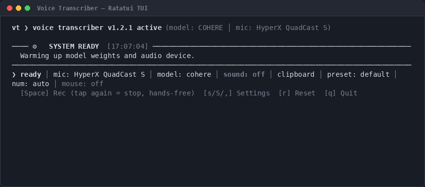
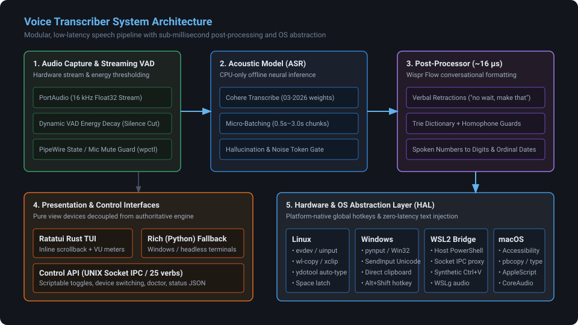
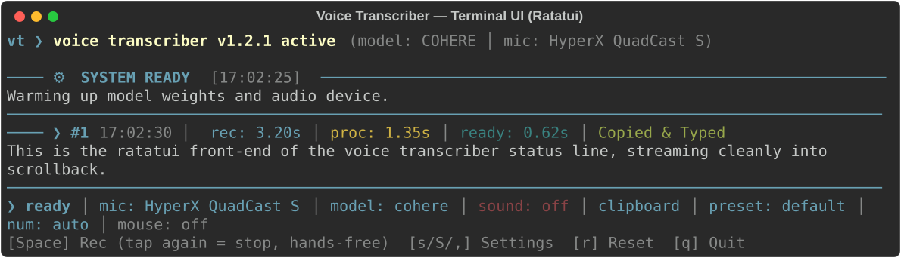

# Building a private, offline voice dictation tool: what I learned along the way

<!-- For cross-posting (Medium, Dev.to, Substack): replace 'assets/' with
     https://raw.githubusercontent.com/jjamesmartiin/voice-transcriber/main/docs/assets/ -->



*The terminal UI — transcriptions scroll above a live status line.*

---

## Why build a local dictation tool?

I spend a large part of my day typing. Over the last couple of years, hosted voice dictation services have become remarkably good: transcription accuracy is impressive and latency is quite low. Still, for my daily desktop setup, I really wanted a solution that ran 100% locally on my own hardware:

1. **Privacy**: I frequently dictate notes about client systems, code, or personal projects where having raw audio streamed to third-party servers isn't ideal.
2. **Reliability**: When traveling or on an unstable internet connection, I want a tool that never stalls on network round-trips.
3. **Simplicity**: No monthly subscriptions, API keys, accounts, or telemetry.

Open-source models like OpenAI's Whisper showed that capable speech-to-text was feasible on consumer machines. But when I set out to turn an acoustic model into a seamless, everyday dictation tool, I ran into practical challenges that I hadn't fully anticipated:

- Models trained on subtitled media often struggle with silence or natural pauses, sometimes hallucinating phrases like *"Thank you for watching!"* when you just paused to think.
- Running speech recognition is only one part of the pipeline. A fluid dictation experience also requires responsive system-wide hotkeys, fast cleanup of spoken corrections and filler words, and reliable text injection across different desktop environments.

[Voice Transcriber](https://github.com/jjamesmartiin/voice-transcriber) is an open-source project I built to address these daily friction points. You hold a global shortcut like `Alt+Shift`, speak naturally, and the transcribed text appears directly in whatever application currently has focus—whether that's your code editor, browser, or terminal.

Here are some of the interesting challenges, architectural decisions, and lessons learned while building it for Linux, Windows, and macOS.

---

## Architecture: one core, four desktop environments

The engine needs to run on Linux (both Wayland and X11), native Windows, Windows via WSL2, and macOS. Because these environments handle global input and audio capture differently, I wanted a design that kept the core logic shared while isolating platform quirks.



*One core, four hosts: only the hotkey, injection, audio, and notification backends differ.*

The cross-platform core handles audio buffering, voice activity detection (VAD), model inference, text cleanup, configuration, and the control API. Platform-specific handling is contained within a dedicated `platform/` module:

| Concern | Linux | Windows | WSL2 | macOS |
| :--- | :--- | :--- | :--- | :--- |
| **Global hotkeys** | `evdev` | `pynput` | PowerShell bridge | `pynput` |
| **Clipboard / typing** | `wl-copy`, `ydotool`/`xdotool` | Win32 `SendInput` | host-side paste | `pbcopy` + AppleScript / `pynput` |
| **Audio cues** | `mpg123` | `winsound` | WSLg | `afplay` |
| **Notifications** | `libnotify` / tkinter | tkinter | tkinter | `osascript` |

Keeping platform checks contained to this single abstraction layer made it much easier to maintain feature parity across operating systems without having logic drift over time.

For the stack itself, Python handles audio capture (PortAudio) and model execution (PyTorch), where the existing library ecosystem is strong. For the terminal interface, a separate Rust process built with [ratatui](https://ratatui.rs) connects over a local socket, keeping UI rendering snappy without competing for Python execution time.

---

## Choosing the acoustic model

By default, the engine uses Cohere Transcribe (`CohereLabs/cohere-transcribe-03-2026`, Apache-2.0, ~3.9 GB of weights). I selected it over Whisper-family models for a few practical reasons:

1. **Silence handling**: Feeding it a quiet room returns an empty string rather than hallucinating text.
2. **Interactive CPU latency**: Dictation needs to feel interactive; speech generally converts to text within roughly a second of releasing the key on modern CPUs.
3. **Permissive licensing**: Apache-2.0 makes distribution straightforward.

*(We also benchmarked **Parakeet TDT 0.6B v3** as a lighter alternative. While Parakeet is faster and uses less memory, Cohere consistently provided higher accuracy across our test suite, so Cohere remains the default model.)*

To evaluate accuracy systematically, I created a reproducible evaluation harness in `eval/` that tests the real pipeline across 154 audio clips with int8 dynamic quantization:

| Slice | Sample Count (N) | Word Error Rate (WER) | Character Error Rate (CER) | Exact Match Rate | Silence Hallucination |
| :--- | ---: | ---: | ---: | ---: | ---: |
| **Clean read speech** | 44 | **2.07%** | 0.72% | 81.8% | — |
| **Noisy speech (5–20 dB SNR)** | 24 | **2.73%** | 1.58% | 75.0% | — |
| **Long-form speech (15–40s)** | 12 | **2.19%** | 0.75% | 33.3% | — |
| **Technical vocabulary** | 28 | **4.52%** | 2.07% | 82.1% | — |
| **Technical + background noise** | 12 | 0.64% | 0.25% | 91.7% | — |
| **Accented meeting speech** | 22 | 9.42% | 3.65% | 36.4% | — |
| **Overall Speech Pipeline** | **142** | **3.57%** | **1.43%** | **70.4%** | — |
| **Silence / Quiet Room Gate** | **12** | — | — | — | **0 / 12 (0.0%)** |

A couple of honest caveats about this data:
- The accented meeting slice (AMI corpus) contains natural disfluencies and repetitions that our post-processor deliberately cleans up, which shows up as errors against verbatim reference transcripts.
- The technical vocabulary slice was synthesized with text-to-speech, so human pronunciation of complex jargon will naturally show higher variance.

Sharing these nuances feels important because single accuracy figures rarely tell the whole story in speech recognition.

---

## Cleaning up natural speech into typed text

When speaking off the cuff, most of us naturally hesitate, repeat words, and correct ourselves mid-sentence:

> "remind me tuesday no wait make that wednesday uh and uh also add a note to the github issue"

Typing out every false start verbatim often requires more time to edit than typing manually. With full cleanup enabled (`cleanup_mode: full`, or pressing `s` in the TUI), the post-processor converts that into clean, formatted text:

> "Remind me Wednesday and also add a note to the GitHub issue."

*(By default, the engine runs in `artifacts` cleanup mode: it scrubs conversational fillers and silence hallucinations while preserving every spoken word verbatim so nothing is accidentally deleted unless you opt into active retraction resolution.)*

This stage runs in approximately **15–35 microseconds** using regular expressions and prefix tries. It deliberately avoids large language models or network calls so it remains instant and predictable:

- **Spoken retractions**: phrases like `"no wait"`, `"make that"`, or `"I mean"` replace the retracted phrase (`"Tuesday, no, Wednesday"` → `"Wednesday"`), while `"scratch that"` clears the preceding clause. Context is preserved so normal phrases like `"there is no Wednesday meeting"` remain untouched.
- **Filler and stutter reduction**: removing conversational fillers like `"uh"` and collapsing repeated words.
- **Numbers and dates**: converting spoken phrases into digits (`"October twentieth twenty twenty five"` → `"October 20th, 2025"`), with configurable modes.
- **Custom vocabulary with context guards**: One small trick that helped avoid errors was adding triggers and guards to the personal dictionary. For example, `"get tea"` should map to `"Gitea"` when preceded by `"push to"` or `"pull from"`, but remain `"get tea"` when preceded by `"cup of"` or `"drink"`:

```yaml
contextual_rules:
  - target: Gitea
    spoken: ["get tea", "git tea", "git ea"]
    triggers_before: ["push to", "pull from", "clone from", "hosted on"]
    triggers_after: ["server", "instance", "repo", "remote", "url"]
    guards: ["cup of", "drink", "hot", "iced", "would you like to"]
```

This prevents specialized developer terms from accidentally corrupting normal everyday speech.

---

### Meeting Mode and local speaker diarization

Push-to-talk works well for short dictation bursts, but meetings are different: they run for an hour or more, multiple people speak, and you don't want text injected into your active editor while listening.

Voice Transcriber includes a dedicated **Meeting Mode** with a separate capture lifecycle:
- It buffers multi-hour audio without excessive memory use by spilling raw audio chunks to temporary files after a configurable threshold (e.g. 10 minutes).
- It streams an in-progress preview to the terminal so you can see live progress.
- When finished, it can run local, on-device speaker diarization (`sherpa-onnx` / `pyannote`) to label different speakers.
- You can name speakers live in the TUI during the call and export formatted Markdown transcripts—entirely offline, with zero audio sent to cloud meeting bots.

---

## Practical stumbling blocks: audio, terminals, and modifiers

Building desktop software often means running into edge cases that aren't mentioned in documentation. Here were three that took time to work through.

### 1. When a muted microphone looks completely healthy

On Linux with PipeWire, an audio source can be muted at the system level. To the audio API, however, the device appears completely normal: it enumerates, opens without error, and reports supported sample rates. But when you record, it quietly fills the buffer with exact zeros (`0.00000000`).

Everything in the software stack looked healthy, but the engine heard nothing. Diagnosing this taught me that "device opens fine, but streams pure digital silence" is a specific condition worth checking for. The tool now includes a `doctor` command that detects this state explicitly and offers to un-mute if needed (`doctor --fix`).

A related quirk with PortAudio is that it caches its device list once at initialization. If another application was holding an exclusive handle to your microphone when the engine started, that device might be omitted entirely. The settings modal now includes a "Reset Microphones" action that re-initializes PortAudio and re-resolves devices by name rather than unstable list indices.

### 2. Terminal redrawing and noisy error streams

The Rust frontend draws an inline TUI in the terminal, while PortAudio writes ALSA errors directly to `stderr`. Initially, probing input devices by attempting to open each one at 16 kHz triggered ALSA errors on incompatible devices, printing directly over the active terminal interface and corrupting the display.

Switching from trial-opening streams to querying device capabilities via `sd.check_input_settings` (`Pa_IsFormatSupported`) cleared the terminal spam completely. It was a good reminder of an issue that was invisible in automated headless tests, but obvious as soon as a human sat down at the terminal.

### 3. Sticking modifier keys

Tracking global hotkeys on Linux requires reading raw input events from `/dev/input/event*`. If you only track key-down and key-up events in memory, a missed key-up event (from an unplugged keyboard, focus change, or key remapper) leaves the modifier stuck down in software.

Querying the kernel's active key bitmap via `EVIOCGKEY` helps, but keyboard remappers (like `kanata`) can report the physical key rather than the remapped key.

The approach that proved most reliable was requiring agreement between both the active event stream and the kernel key state before treating a modifier as held, preventing phantom keypresses.

---

## Injecting keystrokes across different desktop environments

Typing text into the active window requires different strategies depending on the platform:

- **Linux**: Wayland intentionally restricts arbitrary inter-application input synthesis, so typing routes through `ydotool` (via `/dev/uinput`) or `xdotool` on X11, with clipboard support via `wl-copy` or `xclip`.
- **Windows**: Uses Win32 `SendInput` with `KEYEVENTF_UNICODE`, which handles non-ASCII characters and emoji cleanly.
- **WSL2**: The engine runs inside the Linux guest while the target application is on the Windows host. A lightweight PowerShell bridge monitors host hotkeys and coordinates pasting into the active Windows window over a local socket.
- **macOS**: Combines `pbcopy` with AppleScript (`osascript`) for reliable text insertion.

To keep behavior predictable, the key-binding vocabulary and platform mappings are defined in a single file (`keybinds.py`), ensuring that chords and hands-free latch gestures behave consistently everywhere. (For example, tapping `Space` while holding your push-to-talk chord latches recording hands-free until tapped again).

---

## Why the terminal UI and engine are separate processes

The frontend is a Rust binary built on [ratatui](https://ratatui.rs). It connects to the Python engine over a local socket (UNIX domain socket on Linux/macOS, authenticated loopback TCP on Windows) with newline-delimited JSON.



*The frontend renders state received from the engine and sends user commands back.*

The split exists because the two halves have different strengths:
- The engine benefits from Python's PyTorch and PortAudio libraries.
- The terminal UI benefits from Rust's sub-frame redraws and deterministic memory management without garbage collection pauses.

Making the frontend a separate process also provides isolation: the engine remains the authoritative source of state, and if the terminal interface is resized or restarted, background dictation continues running smoothly.

The local socket also acts as a clean control API. You can drive a running instance directly from the command line or scripts:

```bash
python src/main.py status --json
python src/main.py start
python src/main.py stop
python src/main.py wait --json      # returns the completed transcript
python src/main.py hotkey add ctrl+shift
python src/main.py help --json      # machine-readable verb catalogue
```

---

## Packaging model weights for straightforward installation

The Cohere model weights are approximately 3.9 GB. Rather than requiring users to manually configure Hugging Face credentials, the bundle is split into byte-range chunks, compressed with `xz`, and published to a shared prerequisites release:

```
cohere-transcribe-...part1.xz      1.46 GB
cohere-transcribe-...part2.xz      1.46 GB
cohere-transcribe-...SHA256SUMS    268 B
```

On first launch, the client downloads the parts, verifies their SHA-256 checksums, decompresses, and reassembles them using Python's standard library (`urllib` + `lzma` + `tarfile`—no external decompression tools required). Checksums are verified before extraction, ensuring that corrupted downloads are caught immediately.

---

## Mistakes and lessons learned along the way

Retrospectives often highlight the parts that went smoothly, but I ran into plenty of missteps during development.

For example, I waited longer than I should have to enable strict linting. When I finally configured Ruff across the repository, it immediately caught bugs that hundreds of unit tests had missed:

1. **Unbound configuration globals**: Several settings functions assigned values to module variables without declaring them `global`. Python treated them as local variables, meaning settings saved in the UI weren't actually updating the running runtime.
2. **A shadowing import**: A utility function accessed `sys.platform` before an `import sys` statement lower down in the same function, raising an `UnboundLocalError` that was swallowed by a broad `except Exception`.
3. **Unreachable UI states**: The frontend had options in its menu cycle that the backend engine didn't actually implement.

The takeaway for me wasn't just to configure linting earlier—it was a reminder that tests verify our assumptions, not necessarily overall correctness. When tests mock out configuration files or call functions directly, real-world integration bugs can easily slip through.

---

## Testing across four platforms

The test suite is tiered based on dependencies to keep development fast:

| Tier | Needs Model Weights? | Where It Runs |
| :--- | :--- | :--- |
| `tests/shared/` | No | All platforms, every commit |
| `tests/{linux,macos,windows,wsl}/` | No | Platform-specific runners |
| `tests/e2e/` | Yes, plus audio hardware | Locally, optional |

The shared tier is completely hermetic—it uses no network, no microphone, and leaves user configuration untouched. Over 1,830 tests run in seconds across Linux, Windows, macOS, and WSL in GitHub Actions CI.

Being transparent about test limits is also helpful: because GitHub's Ubuntu runners don't have `powershell.exe`, the WSL host bridge is tested structurally (verifying message formats and code tables) rather than end-to-end in CI. Stating clearly what has been tested and what requires physical hardware verification helps keep expectations realistic.

---

## Getting started

If you'd like to try it out on your machine:

- **Linux:** Download `vt-x86_64.AppImage` from [releases], or run via Nix: `nix run github:jjamesmartiin/voice-transcriber`
- **Windows:** Download the installer `VoiceTranscriber-windows-x86_64-setup.exe` or portable `VoiceTranscriber-windows-x86_64.zip` from [releases] (no Python required). Or clone and run `scripts\setup.bat` then `scripts\run.bat`.
- **macOS / from source:** Clone the repo and run `./scripts/setup.sh` then `./scripts/run.sh` (or `nix run .`).

Hold **Alt+Shift**, speak, and release. Tap **Space** while holding to latch hands-free. You can add custom hotkeys at any time with `vt hotkey add <chord>` (or `python src/main.py hotkey add <chord>`). If your microphone is ever quiet, run `doctor` to check system audio levels.

- **Source**: [github.com/jjamesmartiin/voice-transcriber](https://github.com/jjamesmartiin/voice-transcriber)
- **License**: MIT (Model weights: Apache-2.0)
- **Privacy**: 100% local. Zero cloud APIs, telemetry, or user tracking.

Building Voice Transcriber has been a rewarding project. It reinforced for me that while modern open-source speech models provide incredible foundations, turning them into practical daily desktop utilities is largely about the small details—handling quirky audio states, keeping hotkey detection reliable, and getting out of the user's way.

If you have feedback, ideas, or run into issues on your setup, issues and pull requests are very welcome!

[releases]: https://github.com/jjamesmartiin/voice-transcriber/releases/latest
